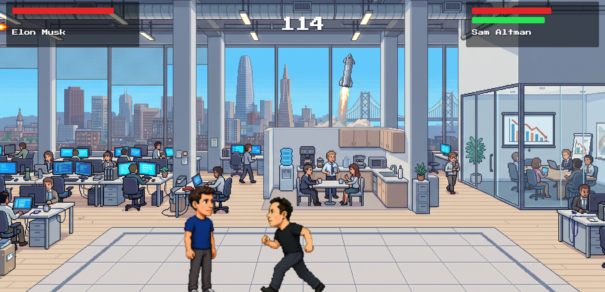

# Elon vs Sam: A 2d pixel fighting game: elon-vs-sam.io

## Modes:

Singeplayer: Play alone vs an AI controlled enemy

Multiplayer: Play locally on the same device against another person

**Running it locally**: Clone the repo and open index.html in your browser

## What I learned

- Writing a state-based player controller that moves both players
- Writing a rule-based algorithm to control the AI
- Sprite-sheet animation

## Disclaimer

This game is a parody and is not affiliated with either person.